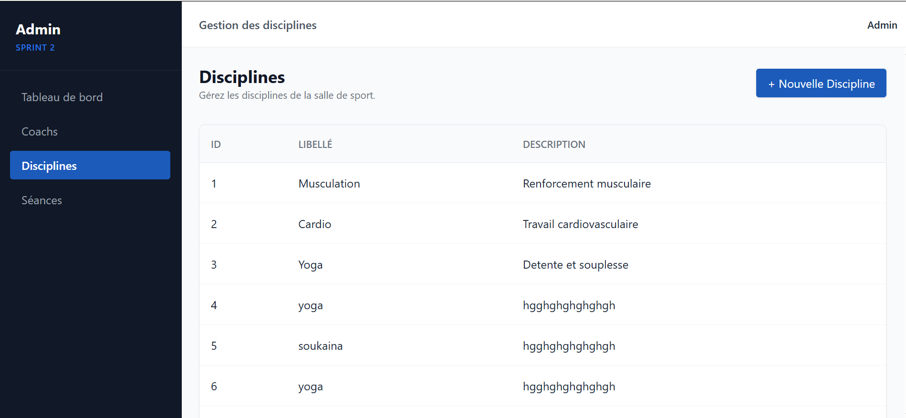
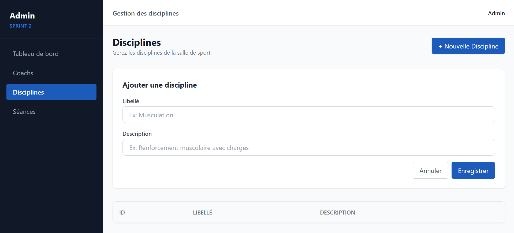

<!-- _class: cover -->
<!-- _paginate: false -->
<!-- _header: "" -->
<!-- _footer: "Centre SoliCode Tanger & OFPPT — Promotion 2026" -->

<!-- Note présentateur : Bienvenue à toutes et à tous, je vous présente aujourd'hui notre projet technique de plateforme web pour la gestion des disciplines d'une salle de sport. -->

 

# Plateforme de Gestion de Salle de Sport

### Présentation du Projet Technique — Gestion des Disciplines

**Présenté par** : Asaas Soukayna &nbsp;&bull;&nbsp; **Encadré par** : ES-Sarraj Fouad

Établissement : **Centre SoliCode Tanger &bull; OFPPT**

---

<!-- header: "Plateforme de Gestion de Salle de Sport | Plan" -->
<!-- footer: "SoliCode & OFPPT | Projet Technique" -->

<!-- Note présentateur : Voici le plan de notre présentation, articulé en cinq étapes clés depuis l'expression des besoins jusqu'à la démonstration du prototype. -->

# Plan de la Présentation

1. **1. Introduction**
2. **2. Besoins du Projet**
3. **3. Analyse & Fonctionnalités**
4. **4. Conception & Données**
5. **5. Réalisation & Prototype**

---

<!-- header: "1. Introduction | Présentation du Projet" -->
<!-- footer: "SoliCode & OFPPT | Projet Technique" -->

<!-- Note présentateur : Cette introduction présente le contexte du projet, une plateforme légère et autonome permettant de gérer les disciplines et les séances d'une salle de sport. -->

# 1. Introduction

- **Plateforme web moderne** pour la gestion d'une salle de sport
- **Gestion des disciplines** (Musculation, Cardio, Yoga...)
- **Suivi des coachs** et de leurs spécialités
- **Stockage léger et autonome** sans base de données SQL
- **Accès rapide** depuis tout navigateur web

---

<!-- header: "2. Besoins | Besoins du Projet" -->
<!-- footer: "SoliCode & OFPPT | Projet Technique" -->

<!-- Note présentateur : Nous abordons ici les exigences fonctionnelles et les critères de performance essentiels pour garantir une utilisation fluide et ergonomique. -->

# 2. Besoins du Projet

### Besoins Fonctionnels :
- **Ajout et affichage** des disciplines
- **Gestion des coachs** (nom, spécialité)
- **Planification des séances** : date, heure, coach, discipline
- **Filtrage direct** des séances par discipline

### Besoins Non Fonctionnels :
- **Performance** : rapidité d'accès aux fichiers JSON
- **Ergonomie** : interface responsive conçue avec Tailwind CSS
- **Sécurité** : validation des formulaires côté client et serveur

---

<!-- header: "3. Analyse | Les Rôles Utilisateurs" -->
<!-- footer: "SoliCode & OFPPT | Projet Technique" -->

<!-- Note présentateur : Cette diapositive détaille les trois profils de la plateforme ainsi que les autorisations spécifiques attribuées à chaque utilisateur. -->

# 3. Les Rôles Utilisateurs

* **Administrateur** :
  - **Gestion globale** de la plateforme
  - **Création et modération** des disciplines
  - **Contrôle complet** des séances et des comptes

* **Coach** :
  - **Gestion de ses propres séances**
  - **Attribution obligatoire** d'une discipline à chaque séance

* **Adhérent** :
  - **Consultation libre** des disciplines proposées
  - **Filtrage par type** et lecture des séances disponibles

---

<!-- header: "3. Analyse | Fonctionnalités Clés" -->
<!-- footer: "SoliCode & OFPPT | Projet Technique" -->

<!-- Note présentateur : Nous découvrons les deux modules principaux du système, dédiés à l'organisation des disciplines et à la planification des séances. -->

# 3. Fonctionnalités Clés

- **Gestion des Disciplines** :
  - **Formulaire dédié** pour l'administrateur
  - **Enregistrement immédiat** dans `disciplines.json`
  - **Affichage automatique** dans le menu et les filtres

- **Gestion des Séances** :
  - **Formulaire complet** : date, coach, discipline
  - **Attribution du statut** : `Planifiée` ou `Annulée`
  - **Génération automatique** de cartes visuelles sur le planning

---

<!-- header: "4. Conception | Architecture du Stockage JSON" -->
<!-- footer: "SoliCode & OFPPT | Projet Technique" -->

<!-- Note présentateur : Cette vue d'ensemble explique notre choix d'une persistance légère au format JSON gérée directement par les fonctions natives de PHP. -->

# 4. Architecture du Stockage JSON

- **Organisation des fichiers** dans le dossier `/data` :
  - `data/disciplines.json` : liste des disciplines
  - `data/coachs.json` : comptes, identifiants et spécialités
  - `data/seances.json` : dates, coachs et disciplines associées

- **Traitement PHP natif** :
  - **Lecture** : `file_get_contents()` et décodage avec `json_decode()`
  - **Écriture** : encodage avec `json_encode()` et `file_put_contents()`

---

<!-- header: "4. Conception | Structure des 3 Tables" -->
<!-- footer: "SoliCode & OFPPT | Projet Technique" -->

<!-- Note présentateur : Nous présentons le schéma des données reliant de façon cohérente les disciplines, les coachs et les séances. -->

# 4. Structure des Données (3 Tables)

- **Table Discipline** : `id`, `libelle`, `description`
- **Table Coach** : `id`, `nom`, `specialite`
- **Table Seance** : `id`, `date`, `id_coach`, `id_discipline`

> **Lien logique** : un **Coach** anime plusieurs **Séances**, chaque **Séance** appartient à une **Discipline**.

---

<!-- header: "4. Conception | Exemples de Données" -->
<!-- footer: "SoliCode & OFPPT | Projet Technique" -->

<!-- Note présentateur : Ce tableau fournit des exemples concrets d'enregistrements pour illustrer l'association entre une discipline et une séance planifiée. -->

# 4. Exemples de Données Enregistrées

### Table Discipline
| ID | Libellé | Description | Créateur |
| :---: | :--- | :--- | :---: |
| **1** | **Musculation** | Renforcement musculaire avec charges | Administrateur |
| **2** | **Cardio** | Travail cardiovasculaire (tapis, vélo) | Administrateur |

### Table Séance
| ID | Date | Discipline | Coach | Statut |
| :---: | :--- | :--- | :---: | :---: |
| **101** | 2024-06-01 | Musculation (1) | Jean Dupont (1) | **Planifiée** |
| **102** | 2024-06-02 | Cardio (2) | Sarah Martin (2) | **Planifiée** |

---

<!-- header: "5. Réalisation | Stack Technique" -->
<!-- footer: "SoliCode & OFPPT | Projet Technique" -->

<!-- Note présentateur : Voici la pile technologique moderne et légère qui compose le projet, associant Tailwind CSS, JavaScript et PHP 8. -->

# 5. Stack Technique Utilisée

- **HTML5 & CSS3** : structure sémantique et socle visuel des pages
- **Tailwind CSS** : design moderne, utilitaires et mise en page responsive
- **JavaScript** : contrôle dynamique des formulaires avant soumission
- **PHP 8** : logique serveur, gestion des requêtes et persistance
- **JSON** : format de stockage structuré, léger et portable

---

<!-- header: "5. Réalisation | Prototype : Page d'Accueil" -->
<!-- footer: "SoliCode & OFPPT | Projet Technique" -->

<!-- Note présentateur : Cette capture montre l'interface d'accueil responsive avec son menu de navigation et sa grille dynamique de disciplines. -->

# 5. Prototype : Page d'Accueil



- **Barre de navigation** &bull; **Grille de disciplines responsive** &bull; **Badges de catégories** &bull; **Tailwind CSS**

---

<!-- header: "5. Réalisation | Prototype : Formulaire d'Ajout" -->
<!-- footer: "SoliCode & OFPPT | Projet Technique" -->

<!-- Note présentateur : Nous visualisons ici l'interface permettant d'ajouter une nouvelle discipline avec son libellé et sa description. -->

# 5. Prototype : Formulaire d'Ajout



- **Champ Libellé** &bull; **Zone de description** &bull; **Validation instantanée**

---

<!-- header: "5. Réalisation | Logique Serveur (PHP & JSON)" -->
<!-- footer: "SoliCode & OFPPT | Projet Technique" -->

<!-- Note présentateur : Cet extrait de code met en avant le traitement côté serveur pour lire, préparer et enregistrer instantanément les disciplines en JSON. -->

# 5. Logique Serveur : PHP & JSON

```php
<?php
// 1. Lecture des disciplines existantes
$jsonPath = 'data/disciplines.json';
$disciplines = json_decode(file_get_contents($jsonPath), true) ?? [];

// 2. Préparation du nouvel enregistrement
$disciplines[] = [
    'id'          => count($disciplines) + 1,
    'libelle'     => $_POST['libelle'],
    'description' => $_POST['description']
];

// 3. Sauvegarde immédiate dans le fichier JSON
file_put_contents($jsonPath, json_encode($disciplines, JSON_PRETTY_PRINT));
?>
```

---

<!-- header: "5. Réalisation | Style Tailwind CSS & Contrôle JS" -->
<!-- footer: "SoliCode & OFPPT | Projet Technique" -->

# 5. Style Tailwind CSS & Contrôle JS

### Carte de discipline en Tailwind CSS :
```html
<article class="bg-white rounded-xl shadow-sm border border-slate-200 p-5 hover:shadow-md transition">
  <span class="inline-block bg-sky-100 text-sky-800 text-xs font-semibold px-2.5 py-1 rounded-full">Musculation</span>
  <h2 class="text-xl font-bold text-slate-800 mt-3">Renforcement musculaire</h2>
  <p class="text-slate-600 text-sm mt-1">Travail avec charges pour développer la force...</p>
</article>
```

---

<!-- _class: cover -->
<!-- _paginate: false -->
<!-- _header: "" -->
<!-- _footer: "Centre SoliCode Tanger & OFPPT — Promotion 2026" -->

<!-- Note présentateur : Pour conclure, ce projet valide un système autonome complet tout en préparant de futures évolutions comme la réservation en ligne et les statistiques. -->

---

# Conclusion & Perspectives

### Bilan du Projet :
- **Application web fonctionnelle** et totalement autonome
- **Cycle complet** de gestion des disciplines et des séances
- **Persistance maîtrisée** avec 3 tables structurées en JSON
- **Interface responsive** moderne réalisée avec Tailwind CSS

### Perspectives d'Évolution :
- **Réservation de séances en ligne** pour les adhérents
- **Espace adhérent** avec suivi personnalisé des activités
- **Statistiques** de fréquentation et de popularité des disciplines