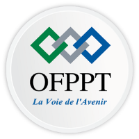
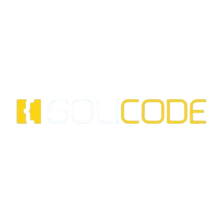
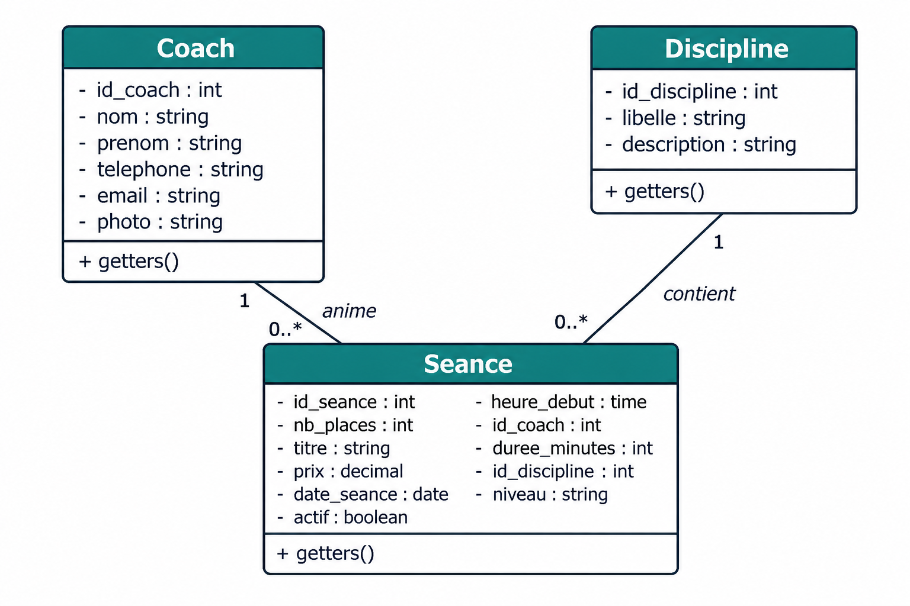

<!-- _class: title -->

<div class="title-logos">
  
  
</div>

<p class="cover-kicker">Lab technique · Programmation PHP</p>

# lab-conception-orientée objet

## Concevoir une application orientée objet

<p class="cover-subtitle">Du besoin au workflow, puis au code PHP</p>

<div class="cover-meta">
  <p><strong>Présenté par</strong><br>Asaas soukayna</p>
  <p><strong>Encadrant</strong><br>ES-SARRAJ Fouad</p>
  
</div>

---

<!-- _class: light -->

## Plan

1. Introduction à la conception logicielle.
2. Problématique : pourquoi concevoir avant de coder ?
3. Workflow de conception orientée objet en huit étapes.
4. Application du workflow au projet de salle de sport.
5. Quick Start et démonstration.
6. Tests et vérification.

---

## Partie 1 · Introduction à la conception logicielle

La conception logicielle prépare la structure de l'application avant le développement.

<div class="process-line">
  <div class="process-node">Besoin</div><span class="process-arrow">→</span>
  <div class="process-node">Conception</div><span class="process-arrow">→</span>
  <div class="process-node">Développement</div><span class="process-arrow">→</span>
  <div class="process-node">Tests</div>
</div>

---

<!-- _class: problem -->

## Partie 2 · Pourquoi concevoir avant de coder ?

Une seule classe qui affiche, vérifie et enregistre mélange plusieurs rôles.

| Sans conception | Avec une conception claire |
|:--|:--|
| Code désorganisé | Parties identifiées |
| Rôles mélangés | Responsabilités définies |
| Modifications dispersées | Changements mieux localisés |

La conception aide à organiser le travail; elle ne supprime pas toutes les erreurs.

---

<!-- _class: light -->

## Partie 3 · Workflow de conception orientée objet

<div class="workflow-grid">
  <div class="workflow-step">
    <strong>01</strong>
    Analyser le besoin et comprendre l'utilisateur
  </div>
  <div class="workflow-step">
    <strong>02</strong>
    Identifier les objets et les classes
  </div>
  <div class="workflow-step">
    <strong>03</strong>
    Définir les responsabilités
  </div>
  <div class="workflow-step">
    <strong>04</strong>
    Définir les attributs et les méthodes
  </div>
  <div class="workflow-step">
    <strong>05</strong>
    Identifier les relations entre les classes
  </div>
  <div class="workflow-step">
    <strong>06</strong>
    Représenter la conception avec UML
  </div>
  <div class="workflow-step">
    <strong>07</strong>
    Vérifier et valider la conception
  </div>
  <div class="workflow-step">
    <strong>08</strong>
    Passer à l'implémentation PHP
  </div>
</div>

On part de la compréhension du besoin, on construit et valide le modèle, puis on passe à l'implémentation.

---

<!-- _class: problem -->

## Étape 1 · Analyser le besoin et comprendre l'utilisateur

**Objectif :** comprendre le problème et identifier les attentes de l'utilisateur.

- **Empathie :** comprendre ses besoins et ses difficultés.
- **Besoins :** recueillir les attentes.
- **Fonctionnalités :** identifier les actions attendues.
- **Périmètre :** définir les limites du projet.

**Résultat :** un besoin clair, des fonctionnalités identifiées et un périmètre défini.

---

## Étape 2 · Identifier les objets et les classes

**Objectif :** repérer les concepts utiles du domaine métier.

1. Relever les éléments importants du besoin.
2. Identifier les objets qu'ils représentent.
3. Créer une classe seulement si elle a des données ou un rôle nécessaire.

**Exemple :** `Discipline` est un objet métier; le formulaire est un élément d'interface, pas automatiquement une classe.

**Résultat :** une liste de classes candidates, sans classe inutile.

---

<!-- _class: light -->

## Étape 3 · Définir les responsabilités

Une classe = un rôle clair.

| Classe du diagramme | Responsabilité générale |
|:--|:--|
| `Coach` | Représenter les informations d'un coach. |
| `Discipline` | Représenter une discipline sportive. |
| `Seance` | Représenter une séance sportive. |

Le tableau explique le rôle des classes du modèle, sans décrire l'architecture interne de l'application.

---

## Étape 4 · Définir les attributs et les méthodes

## Projet · Classes du diagramme UML

| Classe | Responsabilité |
|:--|:--|
| `Coach` | Représenter les informations d'un coach. |
| `Discipline` | Représenter une discipline sportive. |
| `Seance` | Représenter une séance sportive et ses informations. |

**Relations :**
- Un `Coach` anime plusieurs `Seance`.
- Une `Discipline` est liée à plusieurs `Seance`.

---

<!-- _class: light -->

## Étape 5 · Identifier les relations entre les classes

| Relation | Sens | Exemple ou décision |
|:--|:--|:--|
| Association | Deux classes collaborent. | Le contrôleur utilise le repository. |
| Agrégation | Groupe d'objets indépendants. | À confirmer selon le domaine. |
| Composition | Les composants dépendent du cycle de vie du tout. | Non déduite des fonctions demandées. |
| Héritage | Relation « est un ». | Ne pas en ajouter sans besoin. |

Le diagramme fourni indique aussi les multiplicités : un coach ou une discipline est lié à `0..*` séances.

---

## Étape 6 · Représenter la conception avec UML

UML aide à expliquer la conception avant le code.

| Diagramme | Question à laquelle il répond |
|:--|:--|
| Use Case | Quelles fonctions l'utilisateur peut-il demander ? |
| Classes | Quelles classes, données, méthodes et relations ? |
| Séquence | Quels objets échangent, et dans quel ordre ? |

Visibilités : `+` public, `-` privé, `#` protégé. Multiplicités : `1`, `0..*`.

---

<!-- _class: light -->

## Étape 7 · Vérifier et valider la conception

**Avant de coder, vérifier :**

- les rôles et relations sont clairs;
- les diagrammes racontent le même système;
- le modèle couvre ajout et affichage, sans fonctions en plus;
- la conception peut être traduite en PHP.

**Résultat :** une conception simple, cohérente et liée au besoin.

---

## Étape 8 · Passer à l'implémentation PHP

**Objectif :** transformer les éléments validés en classes et collaborations.

**Flux :** classes → attributs et méthodes → collaborations → interface → tests progressifs.

Exemple pédagogique de contrat, à adapter à la conception retenue :

```php
<?php
interface DisciplineRepository
{
    public function ajouter($discipline);
    public function lister();
}
```

---

<!-- _class: light -->

## Partie 4 · Appliquer le workflow au projet

**Besoin :** application web de gestion de salle de sport.

<div class="process-line">
  <div class="process-node">Ajouter une discipline</div>
  <div class="process-node">Afficher les disciplines enregistrées</div>
</div>

**Stack :** PHP orienté objet, Tailwind CSS et UML.

Le stockage et les choix d'architecture ne sont pas précisés dans le README.

---

## Projet · Étape 1 — Besoin et utilisateur

**Objectif :** comprendre le besoin et les grandes parties de l'application.

**Ce qu'on fait :** par empathie, se demander ce dont l'utilisateur a besoin; relever les fonctions attendues et la limite du projet; proposer un premier découpage général.

**Exemple :** l'utilisateur ajoute une discipline ou affiche la liste. Les grandes parties envisagées sont l'interface, le traitement des demandes et l'accès aux données.

**Décision :** garder uniquement ces deux fonctions. Le stockage reste à décider; ce premier découpage ne définit pas encore les classes.

---

## Projet · Classes proposées

| Classe | Responsabilité |
|:--|:--|
| `Coach` | Représenter les informations d'un coach. |
| `Discipline` | Représenter une discipline sportive. |
| `Seance` | Représenter une séance sportive et ses informations. |

**Relations :**
- Un `Coach` anime plusieurs `Seance`.
- Une `Discipline` est liée à plusieurs `Seance`.

---

## Projet · Diagramme de cas d'utilisation

<div class="usecase-diagram">
  <div class="usecase-actor">
    <div class="usecase-person">
      <span class="usecase-head"></span>
      <span class="usecase-torso"></span>
      <span class="usecase-arms"></span>
      <span class="usecase-leg usecase-leg-left"></span>
      <span class="usecase-leg usecase-leg-right"></span>
    </div>
    <span>Utilisateur</span>
  </div>
  <div class="usecase-system">
    <p class="usecase-system-title">Application de salle de sport</p>
    <div class="usecase-row"><span class="usecase-link"></span><span class="usecase-oval">Ajouter une discipline</span></div>
    <div class="usecase-row"><span class="usecase-link"></span><span class="usecase-oval">Afficher les disciplines enregistrées</span></div>
  </div>
</div>

L'acteur générique est relié aux deux fonctions connues. Aucun autre rôle ni droit n'est supposé.

---

<!-- _class: light -->

## Projet · Diagramme de classes fourni



---

## Projet · Parcours des fonctions

**Ajouter**
<div class="project-flow">
  <div class="project-flow-node">Formulaire</div><span class="project-flow-arrow">→</span>
  <div class="project-flow-node">Controller</div><span class="project-flow-arrow">→</span>
  <div class="project-flow-node">Discipline<br><code>libelle</code></div><span class="project-flow-arrow">→</span>
  <div class="project-flow-node">Repository<br><code>ajouter()</code></div>
</div>

**Afficher**
<div class="project-flow">
  <div class="project-flow-node">Controller</div><span class="project-flow-arrow">→</span>
  <div class="project-flow-node">Repository<br><code>lister()</code></div><span class="project-flow-arrow">→</span>
  <div class="project-flow-node">Liste</div><span class="project-flow-arrow">→</span>
  <div class="project-flow-node">Vue</div>
</div>

`DisciplineRepository` définit les opérations. `DisciplineController` coordonne; la vue présente le résultat.

---

<!-- _class: light -->

## Partie 5 · Quick Start · Hello World

Depuis PowerShell avec PHP CLI installé :

```powershell
php -v
php -r 'echo "Hello, conception orientée objet !" . PHP_EOL;'
```

Le README ne fixe pas de version minimale. Vérifier la version disponible avec `php -v` avant de développer.

---

## Partie 6 · Tests et vérification

| Test | Action | Résultat attendu |
|:--|:--|:--|
| Ajout | Ajouter une discipline. | Discipline enregistrée. |
| Liste vide | Consulter la liste. | Liste vide affichée. |
| Liste renseignée | Consulter la liste. | Disciplines affichées. |
| Responsive | Tester sur plusieurs écrans. | Interface adaptée. |
| Collaborations | Vérifier les appels entre classes et les liens UML/PHP. | Rôles et relations cohérents. |

Réaliser les tests progressivement pendant le développement, puis compléter par une vérification globale.

**Résultats et choix réellement retenus :** à compléter après le développement et les tests.